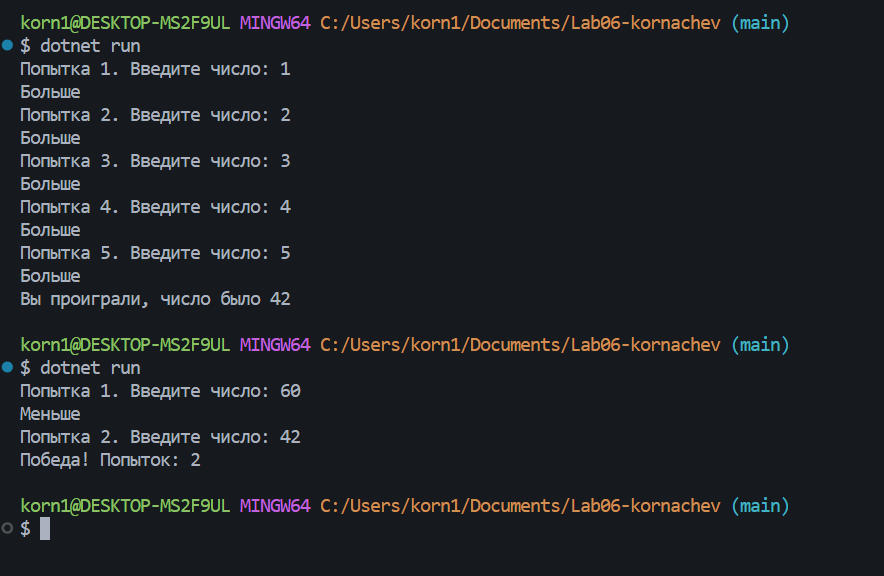
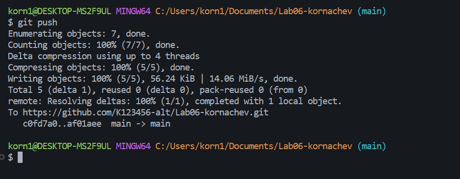

# Практическая работа №6
**Корначев Кирилл Александрович:**
**Группа: ИСП-243**
**Дата: 10.10.2026**
## Что изучено
- `while` проверяет условие до тела, а `do while` — после, поэтому `do while` всегда выполняется хотя бы один раз.
- `break` полностью выходит из цикла, а `continue` пропускает только текущий шаг.
- Сумму и количество считают в переменной, объявленной до цикла, иначе она будет обнуляться на каждом шаге.

